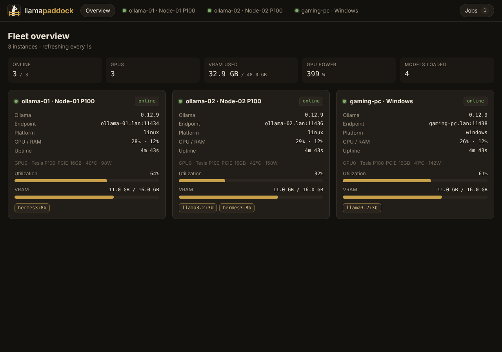
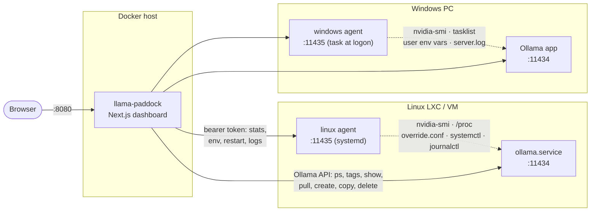
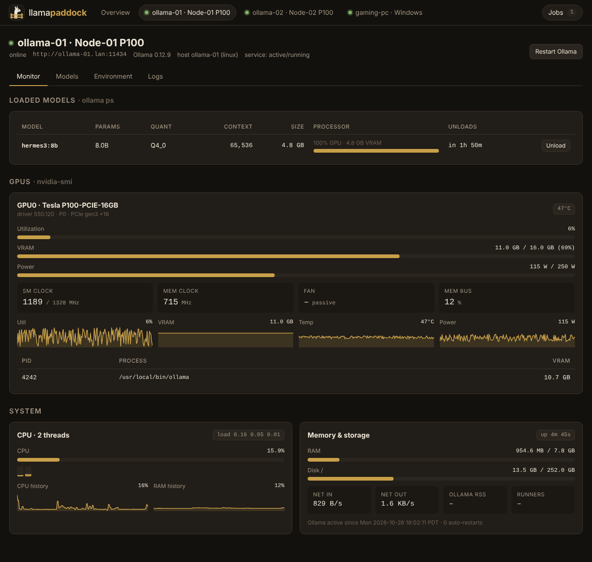
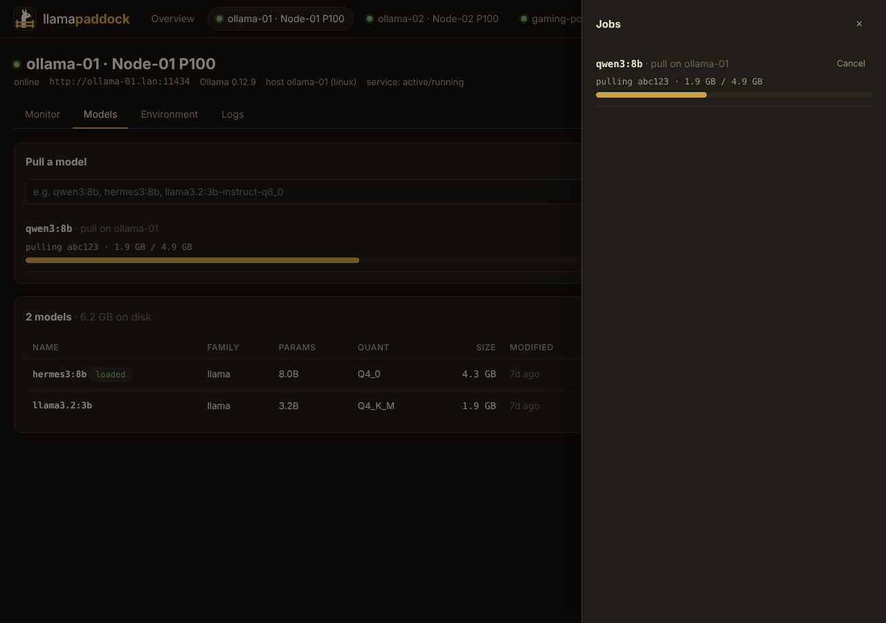
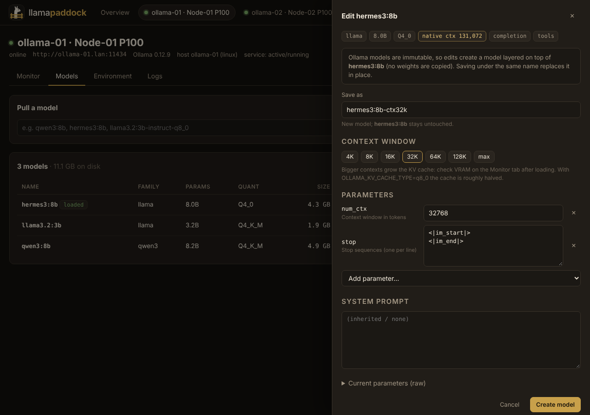
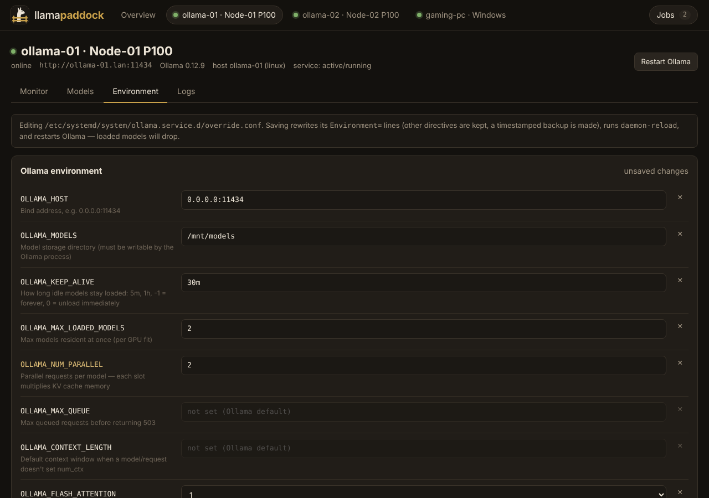
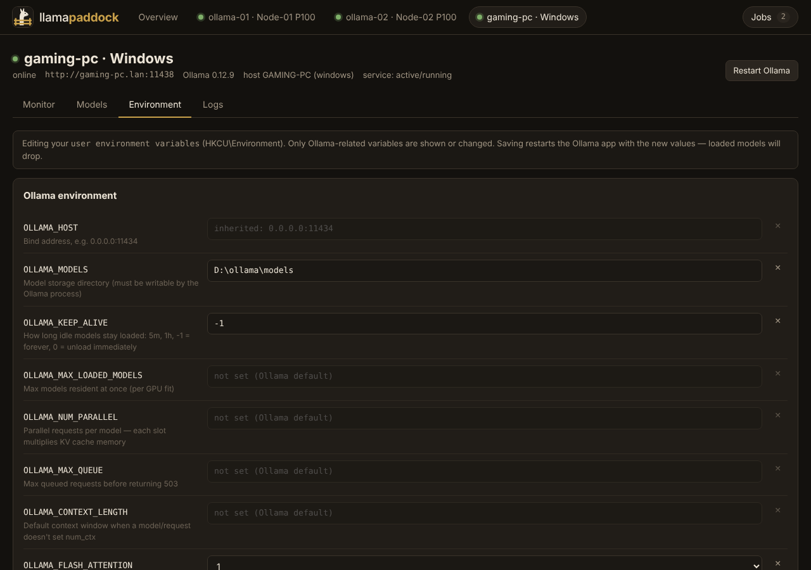

<p align="center">
  <picture>
    <source media="(prefers-color-scheme: dark)" srcset="docs/logo/banner-dark.svg">
    
  </picture>
</p>

<p align="center">
  <a href="https://github.com/SplendidChip758/llama-paddock/releases/latest"></a>
  <a href="LICENSE"></a>
  <a href="https://github.com/SplendidChip758/llama-paddock/commits"></a>
  <a href="https://github.com/SplendidChip758/llama-paddock/stargazers"></a>
  <br>
  
  
  
  
  
</p>

<p align="center">
  <a href="#quick-install">Install</a> ·
  <a href="#using-it">Features</a> ·
  <a href="#api">API</a> ·
  <a href="https://github.com/SplendidChip758/llama-paddock/issues">Issues</a>
</p>

A self-hosted dashboard for monitoring and managing a fleet of Ollama instances on Linux and Windows.

**Monitor:** `ollama ps` (loaded models, context, VRAM/CPU split, unload timer), `nvidia-smi` (utilization, VRAM, temperature, power, clocks, PCIe, per-process VRAM), and host stats (CPU per core, RAM, disks incl. `OLLAMA_MODELS`, network, Ollama memory and runner count), with sparkline history.

**Manage:** pull models with live progress; list, load, unload, copy and delete models; edit models (context window, sampling parameters, stop sequences, system prompt); view and edit Ollama's environment variables and restart Ollama; tail Ollama's logs.



## Quick install

Run these on a **Proxmox VE host**, or inside an existing LXC/VM:

```bash
# Dashboard: creates its own LXC when run on the Proxmox host
bash -c "$(curl -fsSL https://raw.githubusercontent.com/SplendidChip758/llama-paddock/main/install/dashboard.sh)"

# Agent: run on the Proxmox host and pick your Ollama LXC, or run inside it
bash -c "$(curl -fsSL https://raw.githubusercontent.com/SplendidChip758/llama-paddock/main/install/agent.sh)"
```

Windows hosts: see [the Windows agent](#1b-install-the-agent-on-windows).

## Architecture

The Ollama HTTP API can't report GPU stats or change Ollama's own environment, so there are two pieces: a **dashboard** (Next.js, runs in Docker) and a small **agent** on every Ollama host. Both agents are single-file Node.js scripts with zero npm dependencies, and they speak the same HTTP API.



| Piece | Runs where | Does what |
|---|---|---|
| **Dashboard** (`dashboard/`) | Docker container | Polls every instance (background poller started from `instrumentation.ts`), keeps metric history in memory, serves the UI and a JSON API, runs pulls/creates as background jobs that survive a page refresh |
| **Linux agent** (`agent/linux/`) | Each Linux Ollama host, systemd service as root | Stats from `/proc` + `nvidia-smi`; edits `/etc/systemd/system/ollama.service.d/override.conf`, runs `daemon-reload` + `systemctl restart ollama`; tails `journalctl -u ollama` |
| **Windows agent** (`agent/windows/`) | Each Windows PC, Scheduled Task at logon in your session | Stats from Node/`tasklist`/`netstat` + `nvidia-smi`; edits your **user** environment variables (what Ollama for Windows reads); restarts the Ollama tray app with the new values; tails `%LOCALAPPDATA%\Ollama\server.log` |

An instance without an agent still gets `ollama ps` and full model management.

## 1a. Install the agent on Linux hosts

Run this **on the Proxmox host** or **inside the Ollama LXC/VM**:

```bash
bash -c "$(curl -fsSL https://raw.githubusercontent.com/SplendidChip758/llama-paddock/main/install/agent.sh)"
```

- **On a Proxmox host** it lists your containers, pre-selects the one with "ollama" in its name, and installs into it with `pct exec`.
- **Inside the container** it installs directly.

Either way it:
- installs Node.js if it's missing or older than 18.15 (distro package, falling back to NodeSource 22.x),
- installs the agent to `/opt/llama-paddock-agent` and enables `llama-paddock-agent.service`,
- writes `/etc/llama-paddock-agent.env` (mode 600) with a generated token,
- prints the `ollama_url`, `agent_url` and `agent_token` to paste into the dashboard config.

Re-running it, or running `update-llama-paddock-agent` inside the container, updates the agent and **keeps the token**. To share one token across hosts, set `PADDOCK_AGENT_TOKEN=<token>` before the command. Running `bash install/agent.sh` from a clone of the repo uses the agent files in the clone.

The agent runs as root and can restart Ollama, so only the dashboard host should reach port 11435:

```bash
ufw allow from <dashboard-ip> to any port 11435 proto tcp
```

| Setting (`/etc/llama-paddock-agent.env`) | Default | Purpose |
|---|---|---|
| `PADDOCK_AGENT_TOKEN` | generated | Shared secret, required |
| `PADDOCK_AGENT_PORT` | `11435` | Listen port |
| `PADDOCK_OLLAMA_UNIT` | `ollama.service` | Unit to manage |
| `PADDOCK_OVERRIDE_PATH` | `/etc/systemd/system/ollama.service.d/override.conf` | Drop-in to edit (the file `systemctl edit ollama` writes) |
| `PADDOCK_DISK_PATHS` | empty | Extra mount points to report; `OLLAMA_MODELS` is added automatically |

## 1b. Install the agent on Windows

Prerequisite: Node.js 18.15 or newer (`winget install OpenJS.NodeJS.LTS`).

Copy `agent\windows\` to the PC and run the installer **from the account that runs Ollama**. Run it in an admin PowerShell if you want it to add the firewall rule:

```powershell
powershell -ExecutionPolicy Bypass -File .\install.ps1 -AllowFrom 192.168.30.0/24
```

The installer:
- copies the agent to `%LOCALAPPDATA%\llama-paddock-agent`,
- writes `agent.json` with a generated token, readable only by you, and prints the token,
- registers a Scheduled Task, `llama-paddock-agent`, that starts the agent hidden at logon and restarts it if it crashes,
- when elevated, adds an inbound firewall rule for TCP 11435 from `-AllowFrom` (default: local subnet) on Private/Domain networks.

`uninstall.ps1` removes all of it and leaves your Ollama variables as they are.

**Why a logon task instead of a Windows service?** Ollama for Windows is a tray app that runs in your session and reads your account's environment variables. The agent has to live in that same session to restart it correctly. The trade-off is that the agent, like Ollama itself, only runs while you're logged in.

**Ollama on Windows only listens on `localhost` by default.** Once the agent is up, set `OLLAMA_HOST` to `0.0.0.0:11434` in the dashboard's Environment tab. The agent restarts Ollama with it, and the dashboard can then reach the Ollama API.

The Windows agent only ever shows or changes Ollama-related variables (`OLLAMA_*`, `CUDA_*`, `HIP_*`, `GGML_*`, …) plus any custom ones you add through the dashboard. It refuses to touch `Path`, `TEMP` and other system variables.

## 2. Install the dashboard

### One-liner (recommended)

Run this **on the Proxmox host** to create a dedicated LXC, or **inside any Debian/Ubuntu LXC or VM** to install there:

```bash
bash -c "$(curl -fsSL https://raw.githubusercontent.com/SplendidChip758/llama-paddock/main/install/dashboard.sh)"
```

**On a Proxmox host** it asks for:
- distribution (`ubuntu` or `debian`, default `ubuntu`),
- CT ID, hostname, cores, RAM and disk (defaults: next free ID, 2 cores, 1 GiB, 6 GiB),
- storage, bridge, VLAN tag, and DHCP or a static IP,
- optionally your first Ollama instance and its agent token.

It then downloads the latest template for the distribution you pick (latest **Ubuntu LTS** by default, or **Debian**), creates an unprivileged container, and installs the dashboard inside it.

**Inside a container or VM** it:
- installs Node.js 22 if needed,
- downloads the prebuilt dashboard from the latest GitHub release, or builds from `main` if there's no release yet,
- installs it to `/opt/llama-paddock` as the `llama-paddock` systemd service, running as an unprivileged user,
- writes `/etc/llama-paddock/config.yaml` and `/etc/llama-paddock/llama-paddock.env`, including a generated `admin` password,
- prints the URL and login.

Add instances by editing `/etc/llama-paddock/config.yaml`, then run `systemctl restart llama-paddock`. Agent tokens can go in the `.env` file and be referenced as `${AGENT_TOKEN_1}`.

Update with `update-llama-paddock` inside the container, or `pct exec <ctid> -- update-llama-paddock` from the host. Your config is kept.

| Option | Default | |
|---|---|---|
| `PADDOCK_VERSION` | `latest` | a release tag (`v1.2.0`), or `source` to build `main` |
| `PADDOCK_PORT` | `8080` | |
| `PADDOCK_LOCAL=1` | | install on the Proxmox host itself instead of creating a CT |
| `PADDOCK_YES=1` | | non-interactive, accept defaults |

Example: `PADDOCK_VERSION=v0.1.0 bash -c "$(curl -fsSL …/install/dashboard.sh)"`.

### Docker

A multi-arch image is published to GHCR for every release:

```bash
cp config.example.yaml config.yaml   # instance names, URLs
cp .env.example .env                 # agent tokens, dashboard login
docker compose up -d
```

To build the image yourself instead, swap `image:` for `build: ./dashboard` in `docker-compose.yml`. In an unprivileged LXC, Docker needs `nesting=1,keyctl=1`.

`config.yaml` expands `${VAR}` from the environment, so tokens stay in `.env`. Login is HTTP basic auth from `PADDOCK_USERNAME` / `PADDOCK_PASSWORD`. Leave both empty if a reverse proxy with auth already sits in front of it. `/api/healthz` stays open for health checks.

### From source

Requires Node 20.9 or newer:

```bash
cd dashboard
npm ci && npm run build
cp -r .next/static .next/standalone/.next/static
PADDOCK_CONFIG=../config.yaml PORT=8080 node .next/standalone/server.js
```

## Releases

Versions follow [SemVer](https://semver.org) and are released automatically by [semantic-release](https://github.com/semantic-release/semantic-release) from [Conventional Commits](https://www.conventionalcommits.org). See [CONTRIBUTING.md](CONTRIBUTING.md) for how to prefix commit messages.

| Commit / PR title | Bump while `0.x` |
|---|---|
| `fix: …`, `perf: …` | patch (`0.1.0` → `0.1.1`) |
| `feat: …` | minor (`0.1.0` → `0.2.0`) |
| `feat!: …` or a `BREAKING CHANGE:` footer | minor (`0.1.0` → `0.2.0`) |
| `chore:`, `docs:`, `ci:`, `refactor:`, `test:` … | none |

Every push to `main` runs `.github/workflows/release.yml`. When there's something to release, it:
- bumps the version in `dashboard/package.json` and both agents, updates `CHANGELOG.md`, and tags `vX.Y.Z`,
- builds the dashboard once and attaches `llama-paddock-dashboard-vX.Y.Z.tar.gz` to the GitHub release (the one-line installer downloads this),
- attaches both agents and a `SHA256SUMS` file,
- pushes `ghcr.io/splendidchip758/llama-paddock:X.Y.Z`, `:X.Y` and `:latest` for amd64 and arm64.

The workflow only runs when `dashboard/`, `agent/` or the release config change, so docs-only pushes never build an image or cut a release. Dependabot (`.github/dependabot.yml`) opens weekly update PRs; runtime dependency and base-image bumps are titled `fix(deps): …` and ship as a patch release once merged.

Configuration lives in `.releaserc.json`. PR titles are checked by `.github/workflows/pr-title.yml`, since the squash-merge commit is what semantic-release reads.

## Using it

**Monitor tab:** loaded models (Unload button), one card per GPU with sparklines, and host CPU/RAM/disk/network. The processor bar on each loaded model shows the GPU vs CPU split. Anything below 100% GPU means the model plus its KV cache didn't fit in VRAM.



**Models tab:** pull by name (`qwen3:8b`, `gemma3:12b`, …). Progress shows in the Jobs drawer, and the list refreshes when a pull finishes.



*Edit* opens the model editor:
- Context presets from 4K up to the model's native maximum (read from GGUF metadata), or type any `num_ctx`
- Add or remove any parameter (`temperature`, `top_p`, `num_gpu`, `stop`, …) and change the system prompt
- **Save as** defaults to a new name such as `hermes3:8b-ctx32k`. Ollama layers it on the original model, so no weights are duplicated. Using the original name overwrites it in place; a later `ollama pull` of a registry model resets that.

Under the hood this is `POST /api/create` with `from` and `parameters`, the API equivalent of a `FROM` + `PARAMETER` Modelfile.



**Environment tab:** every common `OLLAMA_*` variable with a description, plus any custom variable. Variables set elsewhere are listed read-only, so you can see what you'd override: the main unit or another drop-in on Linux, system-wide variables on Windows.

- **Linux:** only the `Environment=` lines in `override.conf` are rewritten; other directives (`LimitNOFILE=`, `User=`, …) are kept. A timestamped `.bak` is written first (last 10 kept), then `daemon-reload` and a restart.
- **Windows:** the user variables are updated, then the Ollama app is stopped and relaunched with the new values.





**Logs tab:** `journalctl -u ollama` on Linux, `server.log` on Windows, with optional auto-refresh. Errors and warnings are highlighted.

## API

Everything the UI does is plain JSON, so it can be scripted (n8n, Hermes, cron):

| Method | Path | |
|---|---|---|
| GET | `/api/instances` | all instances with latest stats + ps |
| GET | `/api/instances/{id}/history` | metric history |
| GET | `/api/instances/{id}/models` | `ollama list` |
| POST | `/api/instances/{id}/models/show` | `{model}` → details, parsed params, native ctx |
| POST | `/api/instances/{id}/models/pull` | `{model}` → job |
| POST | `/api/instances/{id}/models/create` | `{model, from, parameters, system?}` → job |
| POST | `/api/instances/{id}/models/{load,unload,delete,copy}` | |
| GET / DELETE | `/api/jobs`, `/api/jobs/{id}` | job status / cancel |
| GET / PUT | `/api/instances/{id}/env` | `{vars, restart}` |
| POST | `/api/instances/{id}/restart` | restart Ollama |
| GET | `/api/instances/{id}/logs?lines=500` | log tail |

## Project layout

```
install/          dashboard.sh, agent.sh  (one-line installers)
agent/linux/      paddock-agent.mjs, systemd unit
agent/windows/    paddock-agent.mjs, install.ps1, uninstall.ps1
dashboard/        Next.js app (App Router, TypeScript)
  app/api/        route handlers (the JSON API above)
  lib/server.ts   poller, job runner, Ollama/agent clients
  components/     React UI
  proxy.ts        optional basic auth
.github/workflows release.yml (semantic-release: tag, tarball, agents, GHCR image)
docs/logo/        logo-mark.svg (app icon), banner-dark.svg / banner-light.svg (README header)
```

Development: `cd dashboard && npm install && PADDOCK_CONFIG=../config.yaml npm run dev`.

## Limitations

- Metric history and job state are in memory and reset when the dashboard restarts.
- The Linux agent assumes Ollama runs under systemd, as with the official install script. If Ollama runs in Docker, set its environment in compose instead. Monitoring and model management still work.
- The Windows agent targets the standard Ollama desktop install. If you run `ollama serve` as a Windows service (NSSM or similar), the agent can't manage that service's environment.
- On Windows with consumer GPUs, `nvidia-smi` doesn't report per-process VRAM (a WDDM limitation), so the process table is empty there.
- Removing a parameter in the model editor may not drop it from the derived model if Ollama inherits it from the base layer. To clear one, set it explicitly to the value you want.
