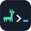

# Brand

The logo, palette and components for llama-paddock's dashboard and website. The website already uses them ([llama-paddock-site](https://github.com/SplendidChip758/llama-paddock-site), `src/styles/theme.css`). This folder is the reference for bringing the dashboard in line.

| File | What |
|---|---|
| [`tokens.css`](tokens.css) | The palette as CSS variables, with the dashboard's names (`--bg`, `--panel`, `--accent`…). Dark and light |
| [`logo/wordmark-dark.svg`](logo/wordmark-dark.svg), [`logo/wordmark-light.svg`](logo/wordmark-light.svg) | The wordmark: llama, prompt, name and cursor |
| [`logo/mark.svg`](logo/mark.svg) | The icon on its tile: favicon, app icon, GitHub avatar |
| [`logo/mark-small.svg`](logo/mark-small.svg) | The icon for 16 px: the llama alone |
| [`logo/llama.svg`](logo/llama.svg) | The bare pixel llama |

`docs/logo/` and `dashboard/components/Logo.tsx` still hold the previous llama-and-fence mark. Replace them when the dashboard moves to this palette, so the README banner, the website's favicon and the app change together.

## Logo

  
  &nbsp;
  

The logo reads as a terminal line: a pixel llama, a `>` prompt, the name, and a cursor.

**Wordmark.** For headers and anywhere the name is shown. In the UI, build it from the parts rather than the SVG, so the name uses the page's font:

- The llama and the `>` are pixel art (12×13 and 5×7 cells). Draw them at a whole-number scale (2× next to 18 px text) with `shape-rendering: crispEdges`, or they blur.
- The llama, the `>` and the name share a baseline (`display: inline-flex; align-items: baseline`). The `>` is cap height, like a letter. The llama's ears rise above the text.
- The name is lowercase `llama-paddock` in the monospace font, weight 600, in the text colour. The `_` cursor is in the secondary colour.
- The cursor blinks four times when the page loads (`animation: blink 1.1s steps(1) 4`) and then stays still. No blinking with `prefers-reduced-motion`.
- The llama's eye is a hole in the shape (`fill-rule="evenodd"`), so it works on any background.
- On a phone, drop the name and keep the llama and the prompt.

**Icon.** `mark.svg` puts the whole line, llama `>` `_`, on a tile. Use it where the icon stands alone: the favicon, the app icon, an avatar. Below 24 px use `mark-small.svg`, the llama alone, since the prompt and cursor turn into noise.

Don't recolour the parts, stretch them, add effects, or put the icon tile next to the wordmark (two prompts in a row).

| Part | Dark | Light |
|---|---|---|
| Llama | `--accent` #45d6ae | `--accent` #0b7f62 |
| Prompt and name | `--text` #eaf1f8 | `--text` #0b1018 |
| Cursor | `--accent2` #61a5fa | `--accent2` #2563eb |
| Icon tile | `--panel` #151d29, border `--line` | the same: the icon is always dark |

## Palette

Dark is the default; light follows the OS or the theme switch. All the values are in [`tokens.css`](tokens.css).

| Role | Dashboard variable | Website variable | Dark | Light | Use |
|---|---|---|---|---|---|
| Background | `--bg` | `--pd-bg` | #0b1018 | #f5f8fb | The page |
| Sunken | `--bg2` | `--pd-bg2` | #0e141e | #edf2f7 | Command blocks, sparkline wells, the app header |
| Card | `--panel` | `--pd-panel` | #151d29 | #ffffff | Cards, drawers, stat tiles |
| Raised | `--panel2` | `--pd-panel2` | #1b2533 | #eef3f8 | Badges, hovered rows inside a card |
| Line | `--line` | `--pd-line` | #223044 | #d5dee8 | Borders, dividers, empty progress tracks |
| Text | `--text` | `--pd-text` | #eaf1f8 | #0b1018 | Headings, values |
| Muted | `--muted` | `--pd-muted` | #a3b1c2 | #4e5d70 | Body text in cards, descriptions |
| Faint | `--faint` | `--pd-faint` | #8b9bb0 | #5e6e82 | Labels, units, meta lines |
| Primary | `--accent` | `--pd-accent` | #45d6ae | #0b7f62 | Primary buttons, the llama, the active tab, selection, utilization and power bars |
| Secondary | `--accent2` | `--pd-accent2` | #61a5fa | #2563eb | Links, the cursor, kickers, VRAM and memory bars, counts |
| On primary | `--on-accent` | `--pd-on-accent` | #0b1018 | #ffffff | Text on a primary or secondary fill |
| OK | `--ok` | `--pd-ok` | #45d6ae | #0b7f62 | Online, done, healthy |
| Info | `--info` | `--pd-info` | #61a5fa | #2563eb | In review, neutral notices |
| Warning | `--warn` | `--pd-warn` | #f5b84a | #9a6400 | In progress, unsaved changes, CPU spill |
| Error | `--bad` | `--pd-bad` | #f2707a | #c8323f | Offline, failed, destructive actions |

Rules:

- **Two accents, each with a job.** Primary is the action and the brand; secondary is information (links, memory). Don't introduce a third accent: status colours are only for status.
- **Compute bars are primary, memory bars are secondary.** GPU utilization and power use `--accent`; VRAM, RAM and disk use `--accent2`. A bar turns `--warn` or `--bad` only when the value crosses a threshold.
- **Contrast.** Every text colour above passes 4.5:1 on both `--bg` and `--panel`, in both themes (dark: faint 6.0:1 on a card; light: faint 4.9:1, primary 4.7:1 on the background). `--on-accent` passes on both accents. Re-check if you add a colour.
- **Tints, not new colours.** For a soft fill, mix an existing colour: `color-mix(in srgb, var(--accent) 12%, transparent)` for a selected chip, 35–45% into `--line` for its border.

## Type

| | Font | Use |
|---|---|---|
| Sans | Inter (`--sans`) | UI text, headings |
| Mono | JetBrains Mono (`--mono`) | Numbers, model names, paths, commands, env vars, section labels, the wordmark |

Both fall back to system fonts, so nothing has to be downloaded. Use `font-variant-numeric: tabular-nums` for numbers that update. Headings use weight 600–700 with slightly negative letter spacing (-0.02em); body text is 400.

## Components

The website's homepage draws the dashboard's main screens with these components (`src/components/AppPreview.astro` in llama-paddock-site), which is a working reference for each one.

**Section label.** Monospace, lowercase, primary, prefixed with a prompt: `> features`, `> loaded models`. On the website it's the `.eyebrow` class (`::before { content: '> ' }`). In the dashboard, uppercase monospace labels in `--faint` (`LOADED MODELS · ollama ps`) stay for dense data screens.

**Kicker.** A small monospace label above a card's title, in the secondary colour, naming the command or area it relates to: `nvidia-smi`, `OLLAMA_*`, `01 · dashboard`.

**Buttons.**

| | Fill | Border | Text |
|---|---|---|---|
| Primary | `--accent` | `--accent` | `--on-accent`, weight 600 |
| Secondary | `--panel` | `--line`, `--accent` on hover | `--text` |
| Quiet (Cancel) | none | none | `--muted` |

Radius 10 px (8 px in dense panels). At least 44 px tall on touch screens.

**Cards.** `--panel` fill, 1 px `--line` border, 10–12 px radius, 12–22 px padding. A card with something in progress may tint its border towards `--warn` (40% mix). No coloured left borders and no gradients.

**Stat tiles.** `--panel` fill with no border, 8 px radius. Label: 10 px uppercase sans in `--faint`, 0.06em spacing. Value: 16–17 px mono, the unit 11–12 px in `--faint` (`32.9 / 48 GB`).

**Progress bars.** 5 px high, 3 px radius, track `--bg`, fill per the palette rules. Put the label and value on one line above the bar (label in `--faint`, value in mono `--text`).

**Chips.** Mono 10.5–11.5 px, 5–6 px radius, 1 px border.

- Model and status chips (`hermes3:8b`, `online`): text `--accent`, border `--accent` mixed 40% into `--line`.
- Neutral (`Q4_0`, `47°C`): text `--muted`, border `--line`.
- Informational (`native ctx 131,072`): text `--accent2`, border mixed 45%.
- Counts (Jobs `1`): `--accent2` fill, `--on-accent` text, fully rounded.

**Status dots.** 7–8 px circles: `--ok` online, `--warn` degraded, `--bad` offline, an empty `--faint` ring for unknown.

**Tabs.** Text in `--faint`; the active tab in `--text` with a 2 px `--accent` underline (`box-shadow: inset 0 -2px 0 var(--accent)`). The host switcher in the header uses pills instead: the active one gets `--panel` and a `--line` border.

**Inputs.** `--bg` fill inside cards, 1 px `--line` border, 8 px radius, mono for values. Focus: `--accent` border. A changed, unsaved value: its name in `--warn` and the border mixed 55% towards `--warn`.

**Presets** (the context window sizes). Bordered pills; the selected one has a `--accent` border and text and a 12% `--accent` fill.

**Command block.** `--bg2` fill, `--line` border, 10–12 px radius. A `>` prompt in `--accent` before the command (not selectable, not copied), mono 13 px, a Copy button on the right. Long commands scroll sideways rather than wrap.

**Sparklines.** A 1.2–1.3 px line with no fill, coloured like the matching bar, in a `--bg2` well with the label and current value above it.

**Dot grid.** The website's hero background: dots 1 px in radius every 22 px, in `--text` at 13% opacity (12% in the light theme). Use it as a backdrop for empty states or the login page at most, never behind data.

## Motion

Keep it rare. The cursor's four blinks, a 0.15 s border-colour change on hover, and the website hero's dot grid. Respect `prefers-reduced-motion` everywhere.
