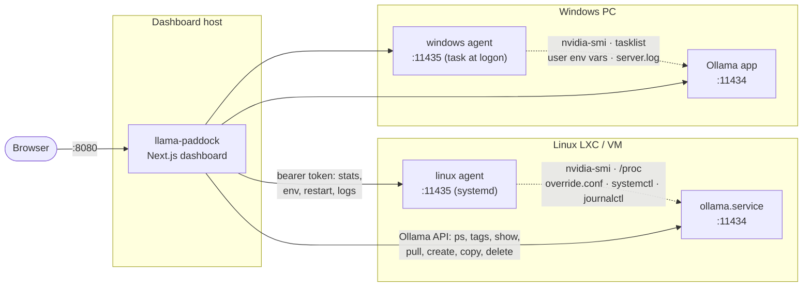

# Architecture

The Ollama HTTP API can't report GPU stats or change Ollama's own environment, so there are two pieces: a **dashboard** (Next.js, runs in Docker or as a systemd service) and an optional **agent** on each Ollama host. Both agents are single-file Node.js scripts with zero npm dependencies, and they speak the same HTTP API.



| Piece | Runs where | Does what |
|---|---|---|
| **Dashboard** (`dashboard/`) | Docker container or Node.js service | Polls every instance (background poller started from `instrumentation.ts`), stores metric history, host availability and model load events, and job state in SQLite in the data directory, serves the UI and a JSON API, runs pulls/creates as background jobs; saved pulls resume after a dashboard restart, while running creates are marked interrupted |
| **Linux agent** (`agent/linux/`) | Each Linux Ollama host, systemd service as root | Stats from `/proc` + `nvidia-smi`; edits `/etc/systemd/system/ollama.service.d/override.conf`, runs `daemon-reload` + `systemctl restart ollama`; tails `journalctl -u ollama` |
| **Windows agent** (`agent/windows/`) | Each Windows PC, Scheduled Task at logon in your session | Stats from Node/`tasklist`/`netstat` + `nvidia-smi`; edits your **user** environment variables (what Ollama for Windows reads); restarts the Ollama tray app with the new values; tails `%LOCALAPPDATA%\Ollama\server.log` |

An instance without an agent still gets `ollama ps` and full model management.

## Source layout

```
install/          dashboard.sh, dashboard-dev.sh, agent.sh (installers)
agent/linux/      paddock-agent.mjs, systemd unit
agent/windows/    paddock-agent.mjs, install.ps1, uninstall.ps1
dashboard/        Next.js app (App Router, TypeScript)
  app/api/        route handlers (see api.md)
  lib/server.ts   poller, job runner, Ollama/agent clients
  lib/db.ts       SQLite metric history, host events and job storage
  components/     React UI
  lib/auth.ts     login, sessions (checked for every request by proxy.ts)
.github/workflows release.yml (semantic-release: tag, tarball, agents, GHCR image; main + dev)
docs/             user guides, API reference, screenshots and logo assets
```

See [Contributing](../CONTRIBUTING.md) for local development and checks.
