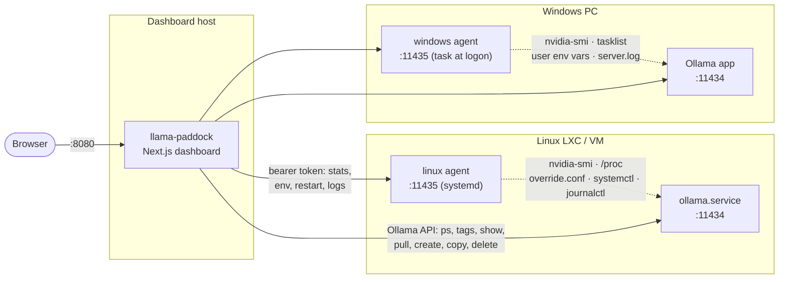

# Architecture

The Ollama HTTP API can't report GPU stats or change Ollama's own environment, so there are two pieces: a **dashboard** (Next.js, runs in Docker or as a systemd service) and an optional **agent** on each Ollama host. Both agents are single-file Node.js scripts with zero npm dependencies, and they speak the same HTTP API.



| Piece | Runs where | Does what |
|---|---|---|
| **Dashboard** (`dashboard/`) | Docker container or Node.js service | Polls every instance (background poller started from `instrumentation.ts`), checks [alert rules](alerts.md) on every poll, stores metric history, host availability and model load events, alert transitions and job state in SQLite in the data directory, serves the UI and a JSON API, runs pulls/creates as background jobs; saved pulls resume after a dashboard restart, while running creates are marked interrupted |
| **Linux agent** ([`linux/`](https://github.com/SplendidChip758/llama-paddock-agent/tree/main/linux) in llama-paddock-agent) | Each Linux Ollama host, systemd service as root | Stats from `/proc` + `nvidia-smi`; edits `/etc/systemd/system/ollama.service.d/override.conf`, runs `daemon-reload` + `systemctl restart ollama`; tails `journalctl -u ollama`; for the [GPU check](gpu-check.md), reads the GPU lines of Ollama's journal since it started and the `nvidia_uvm` state, and reloads `nvidia_uvm` |
| **Windows agent** ([llama-paddock-win-agent](https://github.com/SplendidChip758/llama-paddock-win-agent)) | Each Windows PC, Scheduled Task at logon in your session | Stats from Node/`tasklist`/`netstat` + `nvidia-smi`; edits your **user** environment variables (what Ollama for Windows reads); restarts the Ollama tray app with the new values; tails `%LOCALAPPDATA%\Ollama\server.log`, and reads its GPU lines for the [GPU check](gpu-check.md) |

An instance without an agent still gets `ollama ps` and full model management.

## Source layout

The agents live in their own repositories, [llama-paddock-agent](https://github.com/SplendidChip758/llama-paddock-agent) (Linux) and [llama-paddock-win-agent](https://github.com/SplendidChip758/llama-paddock-win-agent) (Windows), each with its own releases. This repository holds the dashboard, the installers and the tests:

```
install/          dashboard.sh, dashboard-dev.sh, agent.sh (installers; agent.sh installs agent releases)
dashboard/        Next.js app (App Router, TypeScript)
  app/api/        route handlers (see api.md)
  lib/server.ts   poller, job runner, Ollama/agent clients
  lib/alerts.ts   alert rules, evaluated after every poll
  lib/db.ts       SQLite metric history, host events, alert transitions and job storage
  lib/split.ts    GPU/CPU split of loaded models and cloud model detection (server and UI)
  lib/registry.ts model manifests and GGUF metadata from the Ollama and Hugging Face registries
  lib/library.ts  the Ollama library browser: ollama.com's search and tags pages, parsed and cached
  lib/uploads.ts  GGUF uploads for new models: chunks into the data directory, then to Ollama's /api/blobs
  components/     React UI
  lib/auth.ts     login, sessions (checked for every request by proxy.ts)
  bin/            paddock-backup.mjs: full backups and restore, plain Node shipped next to server.js
.github/workflows release.yml (semantic-release: tag, tarball, agents, GHCR image; main + dev)
docs/             user guides, API reference, screenshots and logo assets
```

See [Contributing](../CONTRIBUTING.md) for local development and checks.
