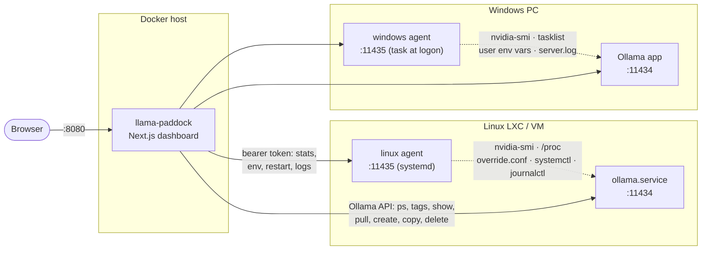

# Introduction

A self-hosted dashboard for monitoring and managing a fleet of Ollama instances on Linux and Windows.

**Monitor:** `ollama ps` (loaded models, context, VRAM/CPU split, unload timer), `nvidia-smi` (utilization, VRAM, temperature, power, clocks, PCIe, per-process VRAM), and host stats (CPU per core, RAM, disks incl. `OLLAMA_MODELS`, network, Ollama memory and runner count), with sparkline history.

**Manage:** pull models with live progress; list, load, unload, copy and delete models; edit models (context window, sampling parameters, stop sequences, system prompt); view and edit Ollama's environment variables and restart Ollama; tail Ollama's logs.

## Architecture

The Ollama HTTP API can't report GPU stats or change Ollama's own environment, so there are two pieces: a **dashboard** (Next.js, runs in Docker) and a small **agent** on every Ollama host. Both agents are single-file Node.js scripts with zero npm dependencies, and they speak the same HTTP API.

| Piece | Runs where | Does what |
|---|---|---|
| **Dashboard** (`dashboard/`) | Docker container | Polls every instance (background poller started from `instrumentation.ts`), stores metric history and job state in SQLite in the data directory, serves the UI and a JSON API, runs pulls/creates as background jobs that survive a page refresh and a restart |
| **Linux agent** (`agent/linux/`) | Each Linux Ollama host, systemd service as root | Stats from `/proc` + `nvidia-smi`; edits `/etc/systemd/system/ollama.service.d/override.conf`, runs `daemon-reload` + `systemctl restart ollama`; tails `journalctl -u ollama` |
| **Windows agent** (`agent/windows/`) | Each Windows PC, Scheduled Task at logon in your session | Stats from Node/`tasklist`/`netstat` + `nvidia-smi`; edits your **user** environment variables (what Ollama for Windows reads); restarts the Ollama tray app with the new values; tails `%LOCALAPPDATA%\Ollama\server.log` |

An instance without an agent still gets `ollama ps` and full model management.
