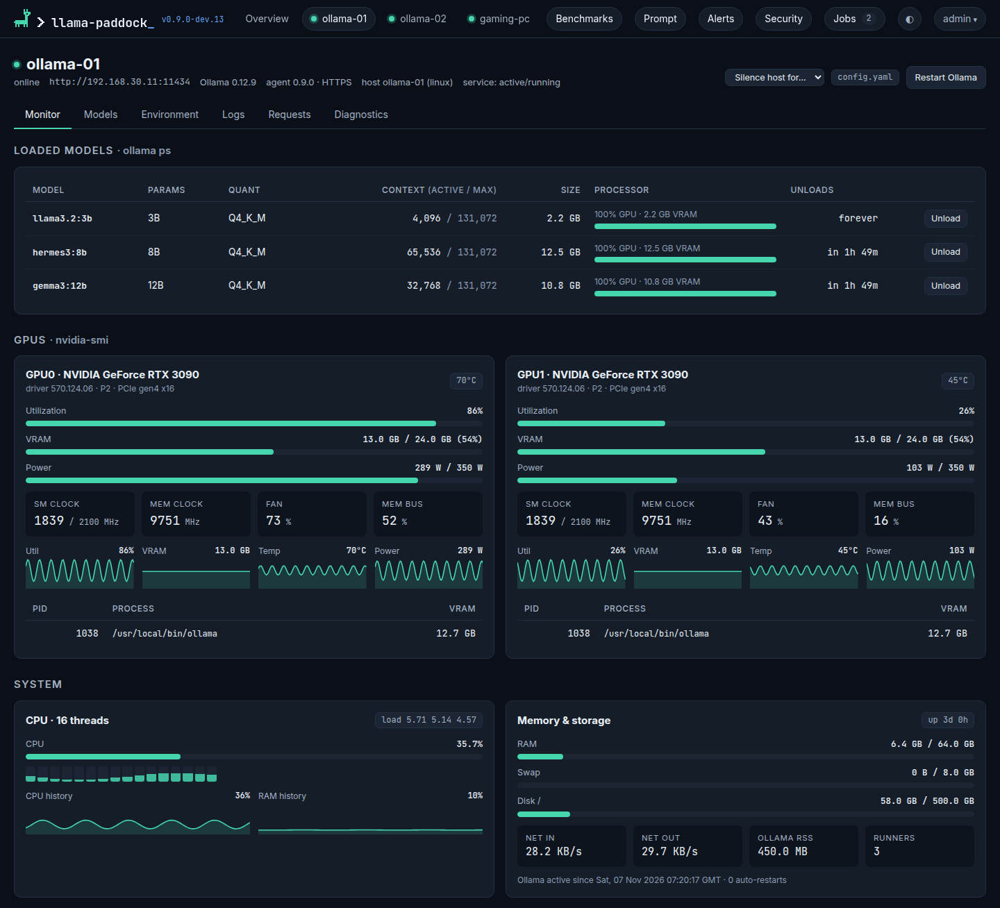
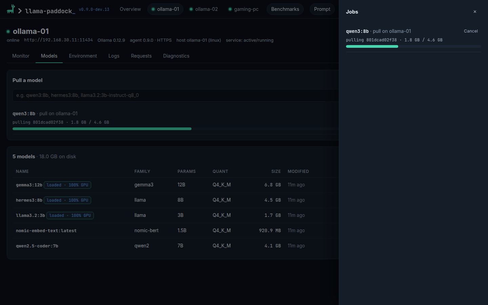
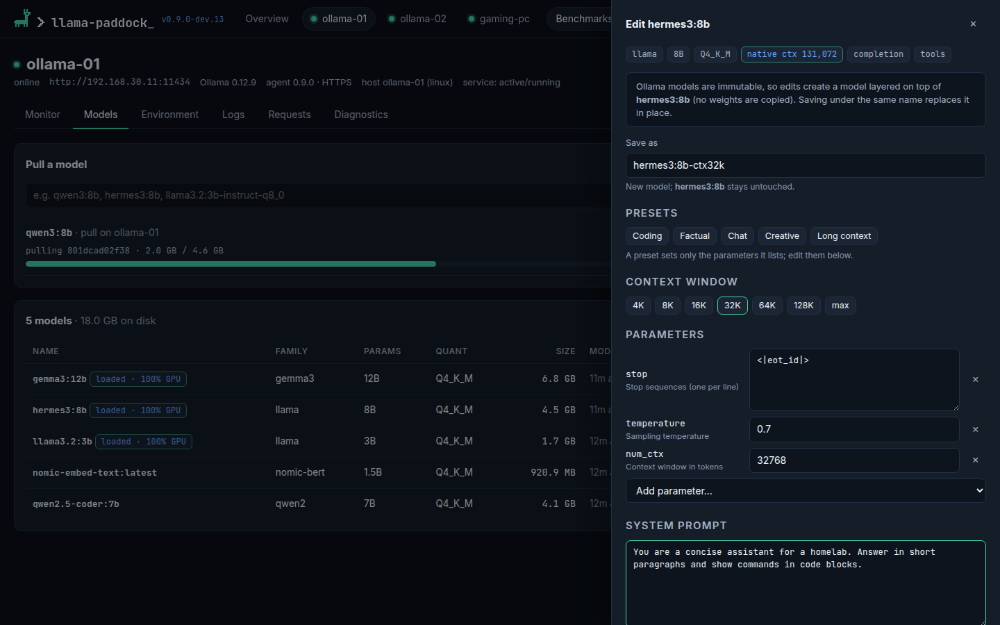
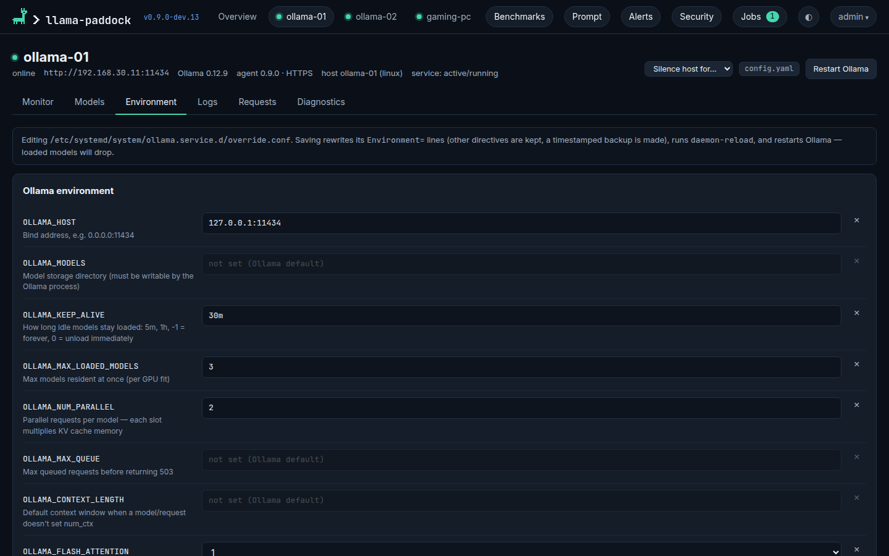
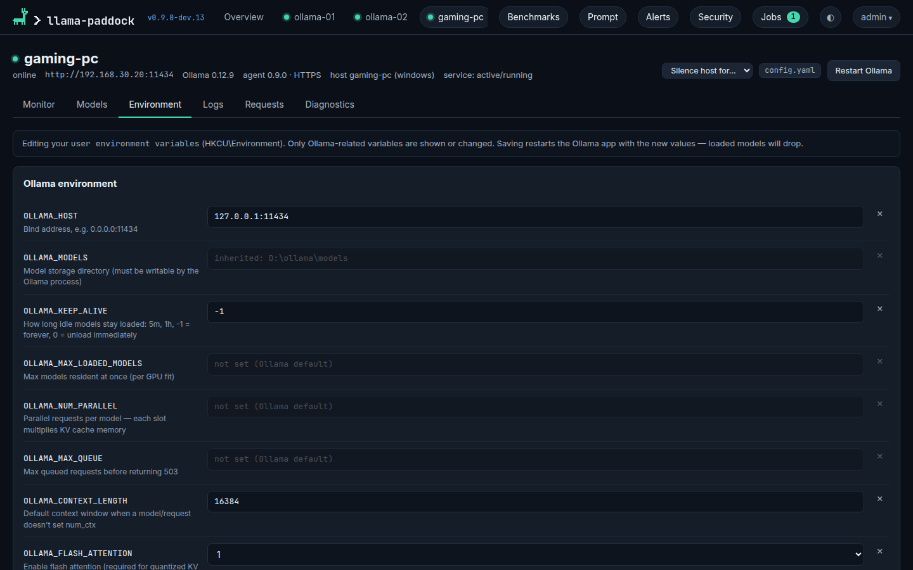

# Use the dashboard

A tour of the dashboard: monitor hosts and their history, manage models, edit Ollama's environment and read its logs. [Alerts](alerts.md) have a page of their own.

## Fleet overview

The home page has one card per host: status, versions, CPU and RAM, and each GPU's utilization and VRAM. Each loaded model is a chip with its GPU/CPU split, such as `qwen3:32b · 62% GPU` (see [GPU/CPU split](#gpucpu-split)). A model that isn't fully on the GPU gets a warning chip and is named under the chips, and the **Models loaded** total counts how many models fleet-wide aren't fully on the GPU.

A host with [alerts](alerts.md) firing gets a red **N alerts** badge that opens its alert history; silenced and acknowledged alerts don't count. **Availability (30d)** is the share of the last 30 days that Ollama and the agent were up, counting only the time the dashboard was watching (see [Monitor](#monitor)).

## Monitor

The Monitor tab shows loaded models (context window, unload timer and an Unload button), one card per GPU (utilization, VRAM, temperature, power, clocks, PCIe link and per-process VRAM, with sparklines), and host CPU per core, RAM, disks including `OLLAMA_MODELS`, network, and Ollama's memory and runner count. The Processor column shows each loaded model's [GPU/CPU split](#gpucpu-split), a placement bar and its VRAM allocation. **Context (active / max)** shows the allocated context and the model's supported maximum, in tokens; it is not a count of tokens used by a prompt. Troubleshooting explanations live on [Diagnostics](#diagnostics), keeping the live table compact.

**History**, at the bottom of the tab, charts the last 1h, 6h, 24h, 7d or 30d: GPU utilization, memory, temperature and power (one line per GPU), CPU, RAM, network in/out, and the VRAM held by loaded models. Hover a chart for exact values. The 6h and 24h ranges show 1-minute averages and 7d and 30d 15-minute averages, and lines break where the host wasn't reachable. The chosen range is remembered in your browser.

**Availability**, below History, shows timelines of Ollama and the agent over the last 24 hours, 7 days or 30 days: up, down, or not yet seen after the dashboard started watching, with stretches the dashboard wasn't running or polling hatched. Each line shows the share of the watched time it was up; unwatched time doesn't count either way, so restarting the dashboard never lowers a host's availability. Below them is the list of outages with when they started, how long they lasted, and the error the poll got. Hover the timeline for the times of each stretch.

**Alerts** on the host show as a pill next to its name, such as **2 alerts**, red while any is firing and pulsing briefly when another fires. Click it to list them and acknowledge or silence each one.  **Silence host for…** next to **Edit host** silences every alert on the host for a while, for maintenance. See [Silences](alerts.md#silences).

**Versions:** the dashboard's version is shown next to the logo, highlighted for a prerelease. Each host shows its Ollama and agent version on its page and its overview card.

## Diagnostics

The Diagnostics tab groups the [GPU check](gpu-check.md), CPU/GPU placement explanations, [context allocation and reload analysis](context-and-reloads.md). GPU evidence, log lines, **Check again** and recovery actions are here. Context cards separate the active allocation, configured value and model maximum, and identify which setting supplied the configured value.

CPU placement and a smaller context can be intentional. These readings help investigate unexpected behavior; a smaller context alone does not prove that a client overrode it or that a prompt was truncated. Alerts and fleet warning badges still surface detected conditions independently of the tab you have open.

## Models

Pull by name (`qwen3:8b`, `gemma3:12b`, …). Progress shows in the Jobs drawer, and the list refreshes when a pull finishes.

A loaded model shows a `loaded` chip with its [GPU/CPU split](#gpucpu-split), such as `loaded · 100% GPU`. Ollama cloud models (`gpt-oss:120b-cloud`, `gemma4:cloud`, …) get a dashed **cloud** badge, and no size, since they take no space on the host.

*Edit* opens the model editor:

- Context presets from 4K up to the model's native maximum (read from GGUF metadata), or type any `num_ctx`
- Add or remove any parameter (`temperature`, `top_p`, `num_gpu`, `stop`, …) and change the system prompt
- **Save as** defaults to a new name such as `hermes3:8b-ctx32k`. Ollama layers it on the original model, so no weights are duplicated. Using the original name overwrites it in place; a later `ollama pull` of a registry model resets that.

Under the hood this calls Ollama's `POST /api/create` with `from` and `parameters`, the API equivalent of a `FROM` + `PARAMETER` Modelfile.

## Test prompt

**Prompt** in the header (or *Prompt* next to a model on the Models tab) opens a chat with a model on a host. The answer streams in as the host generates it, and each reply ends with how fast it came:

| Figure | Meaning |
|---|---|
| Generation | Tokens per second while writing the answer, from Ollama's `eval_count` and `eval_duration` |
| First token | From sending the prompt to the first word of the answer, timed by the dashboard. It includes loading the model and reading the prompt, so it is what a user of the host waits for |
| Load | Time Ollama spent loading the model for this request. Near zero when the model was already loaded |
| Prompt | Tokens per second while reading the prompt (`prompt_eval_count` and `prompt_eval_duration`). Ollama caches a conversation's earlier turns, so later turns read fewer tokens |

*Compare* adds a second column with its own host and model, and each prompt goes to both. Columns on different hosts run at the same time. Two columns on the same host take turns, so neither answer is slowed by the other. *Stop* cancels the answer on the host as well. Changing a column's host or model starts a new conversation in it.

A prompt loads the model like any other request, with the host's usual keep-alive, so it may unload another model that doesn't fit beside it. Running prompts needs an admin account.

<<<<<<< HEAD
## Benchmarks

**Benchmarks** in the header runs a fixed set of prompts against a model, several times, and keeps the results so you can compare hosts, models and quantizations, or one host over time. Pick a model, one or more hosts that have it (*All … with it* picks every host that has the model), the context, the number of repetitions and the model state, then *Run*. Each host's benchmark shows in the Jobs drawer while it runs, and hosts run at the same time.

The prompt set has three prompts:

| Prompt | Measures |
|---|---|
| Short prompt | A short question: time to first token and generation speed |
| Long context | A generated inventory list of about 60% of the context (at most about 8,000 tokens) and a question about it: how fast the host reads a long prompt |
| Long generation | A request to keep counting, cut off at 512 tokens: generation speed over a long answer |

Every run sends the same options: the chosen context as `num_ctx`, temperature 0 and a fixed seed, so every host runs the model at the same size. Each prompt starts with a line unique to the run, because Ollama reuses the cached start of a prompt it has just read and would otherwise skip most of a repeated one.

- **Warm** loads the model first (not timed), then times the answers: what a user of a busy host sees.
- **Cold** unloads the model before every run, so each one includes loading it. The model file may still be in the host's disk cache, so this measures loading into memory, not reading from a cold disk.

Each run records the figures of a [test prompt](#test-prompt), the model's VRAM and GPU/CPU split afterwards, and whether the model was loaded just before it. A run that found the model in the wrong state (for example, something else unloaded it during a warm benchmark) is shown but left out of the figures. The table shows the median of the runs; hover a figure for its range, and `±` is how much the runs varied.

Tick results to compare them side by side. The best figure in each row (the highest rate or the shortest time) is in bold. Below the speeds are the conditions each ran under: model digest and quantization, prompt set, mode, context, Ollama, agent and dashboard versions, GPUs and driver, CPUs and RAM, the Ollama settings that change speed (flash attention, KV cache type, parallel requests and others) and any other models that were loaded. Rows that differ are highlighted, and a note warns when the model, quantization, prompt set, mode or context differ, since then the speeds don't measure the same thing. Each result also lists its warnings. *Show runs* lists every run.

A benchmark keeps the host busy, and other requests to the host during it slow both down: run it when the host is otherwise idle. Results are saved in `paddock.db` until you delete them, also after the host is removed. A benchmark running when the dashboard restarts is marked interrupted and keeps its finished runs. Running a benchmark needs an admin account; viewers can see and compare the results. Without an agent on a host, its GPUs, driver and Ollama settings aren't recorded.

=======
>>>>>>> origin/dev
## GPU/CPU split

Ollama keeps as much of a loaded model as fits in VRAM and puts the rest in system RAM, where the CPU runs it, usually far slower. The dashboard works out the split from Ollama's `/api/ps` (`size_vram` out of `size`, which includes the KV cache for the model's context) the same way on every page:

| Shown | Means |
|---|---|
| `100% GPU` | the whole model is in VRAM |
| `62% GPU` (warning style) | 38% is in system RAM and runs on the CPU |
| `100% CPU` (warning style) | nothing is in VRAM |
| `split unknown` | Ollama didn't report usable sizes, so the dashboard doesn't guess |
| `cloud` | an Ollama cloud model: it runs on Ollama's servers, not on the host |

Warnings are a hint, not an error: a host without a supported GPU, or a model deliberately split to fit a large context, is a valid setup. When it isn't intended, the usual causes are:

- **The context is too large.** The KV cache grows with `num_ctx`. Try a smaller context in the [model editor](#models), or a smaller quantization.
- **Other models are holding VRAM.** Unload them on the Monitor tab, or lower `OLLAMA_MAX_LOADED_MODELS` on the [Environment](#environment) tab.
- **`num_gpu` limits the GPU layers.** `num_gpu 0` keeps every layer on the CPU. Check the model's parameters in the model editor.
- **Ollama didn't find the GPU.** The [GPU check](gpu-check.md) on the Diagnostics tab reads Ollama's log for this, and suggests a fix.

**Cloud models** are marked wherever models are listed, since prompts sent to them leave your network. They take no local VRAM, so they never count towards a host's split.

The [hosts API](api.md#hosts) returns the same result as a `split` object on each loaded model.

## Environment

The Environment tab shows every common `OLLAMA_*` variable with a description, plus any custom variable. Variables set elsewhere are listed read-only, so you can see what you'd override: the main unit or another drop-in on Linux, system-wide variables on Windows.

- **Linux:** only the `Environment=` lines in `override.conf` are rewritten; other directives (`LimitNOFILE=`, `User=`, …) are kept. A timestamped `.bak` is written first (last 10 kept), then `daemon-reload` and a restart.
- **Windows:** the user variables are updated, then the Ollama app is stopped and relaunched with the new values.

When scripting environment changes, send the complete managed variable map: omitted variables on the allowlist are removed. The dashboard editor sends this full map for you. See the [API example](api.md#preserve-existing-environment-settings) to preserve existing settings.

Only variables Ollama and its GPU runtimes read can be set from the dashboard: `OLLAMA_*`, `CUDA_VISIBLE_DEVICES`, `CUDA_DEVICE_ORDER`, `HIP_VISIBLE_DEVICES`, `ROCR_VISIBLE_DEVICES`, `GPU_DEVICE_ORDINAL`, `HSA_OVERRIDE_GFX_VERSION`, `GGML_CUDA_ENABLE_UNIFIED_MEMORY` and the `HTTP_PROXY`, `HTTPS_PROXY` and `NO_PROXY` variables. Other names, such as `LD_PRELOAD`, could load code into Ollama, so a dashboard login must not be enough to set them. To manage another variable from the dashboard, add it to `PADDOCK_AGENT_ENV_ALLOW` in the agent's settings on that host ([Linux](agent-linux.md), [Windows](agent-windows.md#settings-and-updates)). A variable that is already set but not on the list is shown read-only and left as it is when you save.

## Logs

The Logs tab tails `journalctl -u ollama` on Linux, `server.log` on Windows, with optional auto-refresh. Errors and warnings are highlighted.

## Requests

The Requests tab shows the calls made to Ollama on the host over the last hour, day, week or month: how many over time, with the errors in red; per client and per endpoint with their error rates and durations; and per model. Each of those tables shows its 10 busiest rows, with **Show all** for the rest. The **Log** below lists the requests themselves, latest or slowest first, 25 to a page. **Name** next to a client address gives it a name, such as `open-webui`, shown wherever that address appears, on every host.

The agent reads the requests from Ollama's own log (the journal on Linux, `server.log` on Windows), and the dashboard collects them every 10 polls and keeps them for `history_retention_days`. Each line has the time, status, duration, client address, method and endpoint. **No prompts or answers are collected:** Ollama doesn't log them. Monitoring calls (`/api/ps`, `/api/version`) aren't kept, since the dashboard itself makes one every few seconds. The dashboard's other calls, such as the [context check](context-and-reloads.md)'s `/api/show` for a newly loaded model and actions from the Models tab, are kept under the dashboard's address.

Ollama's log doesn't name the model either. A request that runs a model (`/api/generate`, `/api/chat`, `/api/embed`, the `/v1` equivalents) is counted for a model when exactly one model was loaded at the time and the request succeeded; otherwise its model is left blank. The client address is what Ollama saw: behind a proxy, that's the proxy's.

Agents before 0.8.0 don't read the request log; the tab says so until the agent is updated. A line that looks like a request in a format this version doesn't know, as a newer Ollama might write, is skipped and counted at the bottom of the tab.

## History and jobs

Metric history and job state are stored in `paddock.db` in the [data directory](configuration.md#data-directory). The Monitor tab's sparklines show the last `history_points` polls and its History charts the longer ranges; the same data is available through the [history API](api.md#history). The dashboard also records when Ollama and the agent go down or come back and when models are loaded or unloaded, along with the times it wasn't watching, through the [events API](api.md#events).

Alert rules are checked against every poll; see [Alerts](alerts.md).

Pulls and model creation run in the background and stay visible in the Jobs drawer across page refreshes. After a dashboard restart, running pulls resume if their host still exists. Running creates and benchmarks are marked interrupted; check the model list before trying a create again. A benchmark keeps the runs it finished.

Removing a parameter in the model editor may not remove a value inherited from the base model. Set it explicitly to the value you want.
